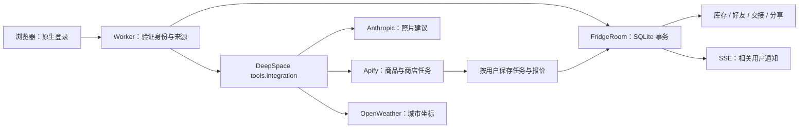
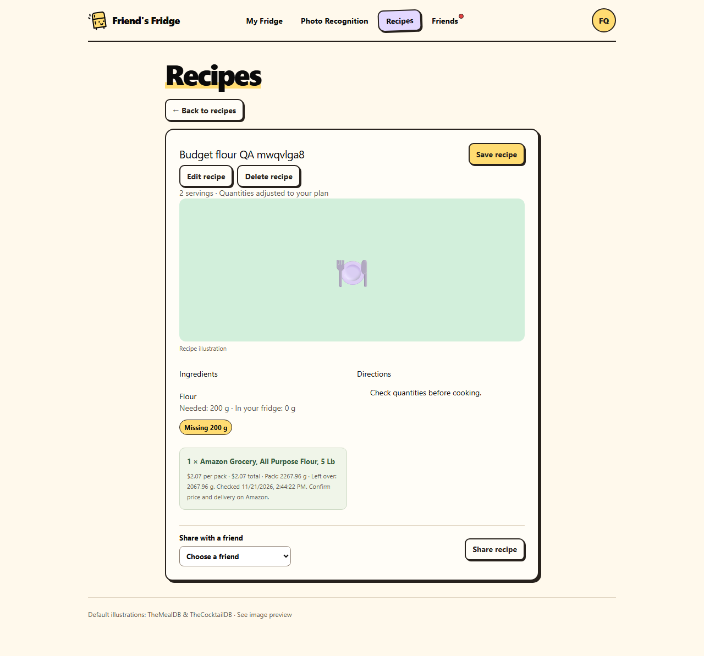
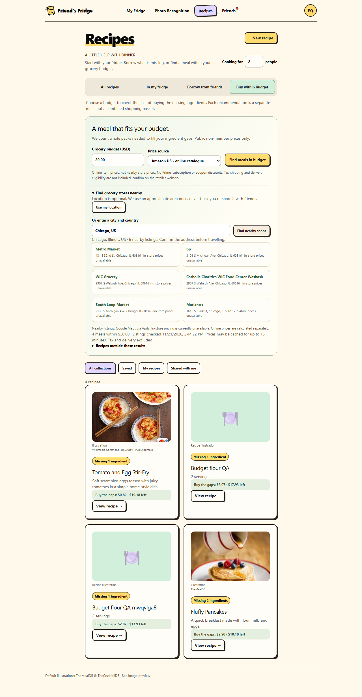
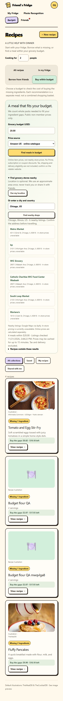

# DeepSpace 提交要求与实现凭据

核对日期：2026-11-21，America/Chicago。本文件记录实际源码、发布与验收证据，不代替提交者亲自验证，也不保证评审一定通过。

> 后续升级源码与完整状态见 [upgrade-acceptance.md](upgrade-acceptance.md)。升级本地已通过 32 项单元测试、10 项浏览器/API 测试，并额外用可控时钟验收报价到期不会发起付费查询；但首次升级线上为 8/10：新 Worker 调用旧数据房间，新增字段/操作被拒绝。故升级尚未完成线上验收，不能将本文件原稳定版的 9/9 直接套用于升级。恢复稳定发布及审批记录见升级文档与机器摘要。

## 1. 提交入口与版本

| 项目 | 可核对内容 |
| --- | --- |
| 在线应用 | [Friend’s Fridge](https://friends-fridge-jianghui.app.space) |
| 评审源码入口 | [deepspace-migration / deepspace-app](https://github.com/cccuirq/FriendsFridge/tree/deepspace-migration/deepspace-app) |
| 运行目录 | `deepspace-app/`；仓库根目录仍保留原 Node/MongoDB 课程项目 |
| 原项目基线 | `9f1e164`，VOE-Du，2026-11-18，`Add recipe sharing invitations with chat acceptance and removal` |
| 当前业务版本的权威源码 | DeepSpace cloud source commit `ae55190629107ab1e06d260d847532c46f4c95ed` |
| 当前业务版本发布 | `rel_01M7ZX2TWMS8R43NCVSVESSAAE` |
| 平台部署结果 | `serving: confirmed`、`dataPlane: confirmed`、`dirty: false`、`recoverable: true` |
| 应用身份 | `app_01M7T9Z1CJZANYFXBFTZ2M1FQM`，复用用户授权替换的 MemoryFlow 身份 |

DeepSpace 云仓库是该应用已绑定的源码权威；GitHub 分支是供评审阅读的迁移副本。报告、截图和测试隔离修正可能晚于上述业务发布提交，不能把文档更新误认为又发布了新的业务代码。原 MemoryFlow 源码仍在历史中；迁移没有执行 undeploy 或清空存储。

## 2. 逐条对应 Build Exercise 要求

| 要求 | 已实现及凭据 | 边界 / 仍需做的事 |
| --- | --- | --- |
| 在 DeepSpace 构建并部署全栈应用 | React/原页面业务 UI → Hono Worker → SQLite Durable Object；通过原生 CLI 部署。见 [worker.ts](../worker.ts)、[wrangler.toml](../wrangler.toml)、[room.ts](../src/fridge/room.ts)。 | 运行目录必须是迁移子目录，不能拿根目录旧 MongoDB 启动方式当作新版本。 |
| 五天内选择合理范围，完成比数量重要 | 基于已有五人课程项目保留业务流程，本次重点为原生登录、云存储事务、照片识别和库存/借用/预算的一条做饭路径。 | 不声称全部课程项目是五天内由个人从零完成；原团队贡献必须说明。 |
| 交互深度高于简单习惯记录 | 独立账号 → 私密库存 → 好友共享 → 缺口匹配 → 借用/整包补购 → 一次性交接。具有真正的跨用户授权、状态流转和金额/单位计算。 | 不支持自动下单、多菜谱合并购物篮、库存预留或自动单位猜测。 |
| 重要路径实际可用 | 22 项单元测试通过；9 项浏览器/API 测试在本地通过；最终线上 9/9 通过（58.0 秒），其中购物测试使用真实供应商。见第 5 节和 [collab.spec.ts](../tests/collab.spec.ts)。 | 这是自动化与代理验证；真实 Google/GitHub 授权、真实手机和提交者自己的操作需另行完成。 |
| 集成必须改善产品，不凑数量 | 原生 Auth 解决账号；SQLite 解决事务与持久化；原生 Anthropic 解决照片建议；原生 Apify 提供商品/附近商店数据；OpenWeather 支持手动城市定位。见第 3 节。 | 不把保留的 Yjs/Canvas/Cron/Job 模板类说成已使用的产品集成。没有加入不相关的邮件、日历或支付。 |
| 平台原语优先，不无理由重复实现 | 登录/JWT 会话由 SDK 提供；数据用平台 SQLite DO；云源码和部署用 DeepSpace CLI；集成使用 `tools.integration`。见 [登录页](../src/pages/(app)/home.tsx)、[请求鉴权](../src/fridge/routes.ts)、[集成配置](../src/integrations.ts)。 | 原有业务 API 为保留业务行为而迁移；没有再搭建外部 MongoDB、密码系统或本地 Python 识别服务作为云端依赖。 |
| 代码可理解、秘密受保护 | 请求先验证原生身份；私密库存与分享由服务端检查；不把 token 放入 URL；凭证由平台/CLI 管理。本次源文件路径检查未发现被追踪的 `.env`、`.dev.vars`、`.wrangler`、`.deepspace` 或 `node_modules`。 | 路径检查不等于全面安全审计；见 [优化评估](optimization-review.md) 中的代码结构与规模建议。 |
| 说明取舍与未完成边缘 | 第 4 节说明单房间快照、SQLite 图片、网上报价替代门店价、查询成本与保守规格匹配。 | 有限预算查询范围、任务恢复、即时库存刷新和完整无障碍审查仍有改进空间。 |
| 说明 AI 与申请者分别做了什么 | 第 7 节区分代理实施、自动化证据、用户作出的决策和待人工验证清单。 | 不把代理点击和自动化通过写成“申请者已亲自验证”。 |
| 提交 URL、仓库和短说明 | 本文件第 1 节提供 URL/源码；[SUBMISSION.md](../SUBMISSION.md) 提供英文草稿和人工清单。 | 最终 portal 提交由用户完成；本次没有代为提交申请或发送消息给评审。 |

## 3. 技术深度与源码定位

### 3.1 原生登录与权限

- [home.tsx](../src/pages/(app)/home.tsx)：使用 `AuthGate`、`getAuthToken`；首次登录补充应用用户名、展示名和联系邮箱。
- [routes.ts](../src/fridge/routes.ts)：使用平台 `resolveAuth`，只读媒体/SSE 使用 SDK 的受限会话读取能力；写请求检查来源；内部 subject 由 Worker 设置。
- [domain.ts](../src/fridge/domain.ts)：所有权、已接受好友、库存可见性、菜谱分享状态一起决定访问权限。好友搜索返回公开资料，不返回联系邮箱或原生 auth subject。
- 联系邮箱不是登录凭证；旧密码和原 MongoDB 私人数据没有自动上传到新应用。

### 3.2 原子库存交接与一致性

- [domain.ts](../src/fridge/domain.ts) 的 `status === 'completed'` 分支：再次验证提供者库存、扣除数量、增加接收者库存、更新请求状态。
- [room.ts](../src/fridge/room.ts) 的 `storage.transactionSync`：以上步骤和持久化一起成功或一起回滚。
- `expected_quantity` 防止旧页面覆盖新库存；`batch_id` 与规范化指纹防止照片确认重复入库；消息 ID 防止重复发送。
- [collab.spec.ts](../tests/collab.spec.ts) 同时提交两次完成操作，断言一个成功、另一个冲突，并检查库存只扣一次。

### 3.3 照片、图片与实时更新

- [vision.ts](../src/fridge/vision.ts)：通过原生 Anthropic 集成调用 Haiku 4.5；严格校验返回名称/坐标，不编造置信度，数量必须人工填写。
- [vision.test.ts](../src/fridge/vision.test.ts)：覆盖非法模型结果、非字典食材和无效坐标。
- [room.ts](../src/fridge/room.ts)：图片以授权读取的 SQLite BLOB 保存，照片修改/删除与状态更新在事务内处理；私密菜谱图片需要现行查看权限。
- 好友、聊天和相关库存变化使用按用户通知的 SSE；不能把“朋友聊天”宣传成平台大模型聊天功能。

### 3.4 借用与预算规划

- [domain.ts](../src/fridge/domain.ts)：按人数向上取整计算缺口，只收集 accepted 好友公开给朋友的正库存。保留 `base_required`，避免人数调整意外改写原菜谱。
- [shopping-math.ts](../src/fridge/shopping-math.ts)：使用整数分计价；只转换明确规格；包数为 `ceil(缺口 / 每包数量)`；缺价永远不是零元。
- [shopping.ts](../src/fridge/shopping.ts)：原生 Apify 调用、异步任务、有限候选、供应商超时、价格结果和城市查询。
- [room.ts](../src/fridge/room.ts)：报价任务绑定当前用户，重复 ID 不重复启动；限流、短轮询锁、15 分钟报价缓存与一小时任务过期。
- [meal-planner.js](../public/legacy/js/pages/recipes/meal-planner.js)：独立做饭方式/收藏筛选、手动定位替代、缺价说明、整包采购明细和明确借用请求。



Apify 是外部任务执行方；应用自己用 SQLite 保存任务状态。保留的 `AppJobRoom` 并不是这套商品采集的执行器，不能混淆。

## 4. 已作出的主要取舍

| 选择 | 实际原因 | 明确不承诺什么 |
| --- | --- | --- |
| 一个 SQLite 房间、8 MB 业务快照 | 用同步事务清楚处理跨用户交接，在演示规模内保持迁移小而可解释。 | 不是无限规模的公共聊天/库存服务；扩大规模前应规范化表、加索引和保留策略。 |
| 图片另存 SQLite BLOB，单张 2 MB、总计 20 MB | 免费账号的 R2 绑定被平台拒绝，改用已有 SQLite 能力，不要求升级账号。 | 目前没有对象存储级别的海量媒体能力。 |
| Haiku 替代原本尝试的 Florence-2 | Florence-2 最低预留超过可用 credits；小型 Haiku 请求已真实成功。 | 不是免费无限识别，也不保证和原 YOLO/CLIP 输出相同。 |
| Amazon US 网上公开价，附近门店只列地址 | 平台 SerpApi/内置 Amazon 搜索共享的上游额度耗尽；独立 Apify 路径已实测可用，且用户明确同意网上价替代方案。 | 不是当地门店收银价；不保证送达地址、税费或配送金额，不套用会员优惠。 |
| 每次优先四道接近库存的菜、最多六种缺口食材 | 控制采集费用、条数与响应时间。 | 不是穷举全部食谱或全市场最低价；未查/无法匹配的菜不能算预算内。 |
| 不猜测包装重量和会员折扣 | 错误的确定金额比明确缺价更容易误导用户。 | 规格覆盖率有限，不以 AI 猜数填补缺失价格。 |

更详细的成本、缓存和供应商适配说明见 [meal-planning.md](meal-planning.md)。后续优化见 [optimization-review.md](optimization-review.md)。

## 5. 已执行的验证记录

| 检查 | 实际结果 | 覆盖内容 |
| --- | --- | --- |
| 干净依赖安装 | `npm ci` 成功 | 锁文件可复现；使用受支持的 Node/npm。 |
| 类型与单元测试 | `npm run validate`：22/22 通过 | 库存约束、配方引用、隐私、人数换算、规格解析、整包金额、缺价和模型结果。 |
| 生产构建 | `npm run build` 成功 | Worker、前端和静态入口均生成。 |
| 本地浏览器/API | 9/9 通过 | 原有完整业务、手动门交互、借用和响应式规划界面。 |
| 本地真实购物集成 | 9/9 通过，约 1.2 分钟 | 无模拟价格，真实商品采集、城市查询和附近商店列表。 |
| 最终线上回归 | 9/9 通过，58.0 秒 | 独立账号、真实报价、他人不可读取任务、相同 ID 重放不新建任务、手动城市与浏览器定位流程、手机无横向溢出。 |
| 生产日志 | 核对窗口 10 分钟，error 事件数 0 | 这是该窗口的运行日志结果，不等于永久无错误。 |

线上回归曾因测试账号原有库存/可见性与测试假设不一致而失败，不能把该次 8/9 写成全通过。借用/预算专项用例现已显式构造缺口、设置共享可见性、使用独立测试菜谱名，并在 `finally` 中恢复相关面粉库存；最终结果为上表的 9/9。

机器可读摘要见 [verification-record.json](evidence/verification-record.json)。该摘要整理自本轮已执行的工具结果，方便核对；它不是独立 CI 服务签名或第三方认证。

### 可复现命令

```powershell
cd D:\cs409_project\deepspace-app
npm ci
npm run validate
npx deepspace test run all --port 5198
npm run build

# 下面这一组针对生产站点，会使用原生测试账号，且真实商品/地图调用会消耗 owner credits。
$env:FRIDGE_TEST_URL = 'https://friends-fridge-jianghui.app.space'
$env:FRIDGE_SHOPPING_LIVE = '1'
npx playwright test --config tests/playwright.config.ts --workers 2
```

测试账号凭证由 CLI 本机存储管理，不在仓库中。浏览器定位测试使用公开芝加哥测试坐标，证明授权后调用链可用，不代表测量了用户实际 GPS 精度。

## 6. 当前线上截图凭据

以下是本轮自动化验收产生、已经打开检查的原始截图。账号和测试菜谱为 QA 数据；其中“Budget flour QA”只用于验证数量与费用公式，不是一道真实烹饪建议。截图中的价格只证明当时取得过该公开报价，不是后续价格承诺。

### 6.1 商品、包装、金额与余量



本次公开示例：5 lb 面粉，显示每包 $2.07；需要 200 g 时购买一包，而不是只按 200 g 比例计价。规范化包装数量为 2,267.96 g，展示余量 2,067.96 g，同时给出商品链接与检索时间。

### 6.2 网上预算与附近商店明确区分



附近门店明确标注价格不可用；预算结果使用 Amazon US 网上价。列表还展示真实示例菜谱，不把测试菜谱当作产品内容充数。

### 6.3 手机布局



390px 视口的自动化检查没有横向溢出。展开六家附近商店后纵向内容较长，这是下一轮可优化的实际问题，而不是“已达到完美移动体验”的证明。

## 7. 代理与用户分别做了什么

**代理实际完成：**阅读原项目和平台文档、搭建迁移版本、实施身份与事务边界、图片识别与存储、UI 及预算数据链、自动化测试、错误定位、CLI 发布与日志检查、凭据和取舍文档。

**用户明确作出的决策：**指定 VOE-Du 版本作为基线；保留全部业务流程；同意原生登录；授权替换 MemoryFlow；要求门体厚度/自然铰链/保持打开；改为仅点击门开关；确认非会员计价、借用与预算两个选项；在门店接口不可用后同意网上报价替代。

**不能替用户宣称已完成：**亲自走过 Google/GitHub OAuth、真实手机触控/屏幕阅读器、实际购物结算和现实食材交接。请在 [SUBMISSION.md](../SUBMISSION.md) 的人工清单中填写自己真正做过的检查。

原项目为五人课程项目。本次迁移和代理辅助工作应如实说明，保留图片来源，不把全部旧代码写成申请者个人原创。也不要把 DeepSpace 的“可以进入 live coding”标准说成已经获得录取或后续有薪岗位承诺。

## 8. 面试前应该能解释和修改的内容

1. 为什么身份来自已验证的原生会话，不能相信前端传来的 user ID。
2. 为什么 `accepted` 不扣库存、`completed` 必须在一个事务内转移库存；并发点击如何只成功一次。
3. 为什么 5 lb 面粉只缺 200 g 时也计一整包，以及单位不能换算时为什么拒绝给预算结论。
4. 为什么附近商店列表不等于当地门店价格，为什么缓存必须带时间和过期边界。
5. 如何读出 `upstream_provider_error`、固定一个可复现假设并验证，而不是把供应商错误伪装成成功。
6. 如何修改单房间容量、报价配额或预算筛选，并运行相应测试。

建议现场演示按“原生登录 → 库存 → 借用或预算 → 请求/采购明细 → 事务与权限解释”推进，重点展示一条完整路径。
