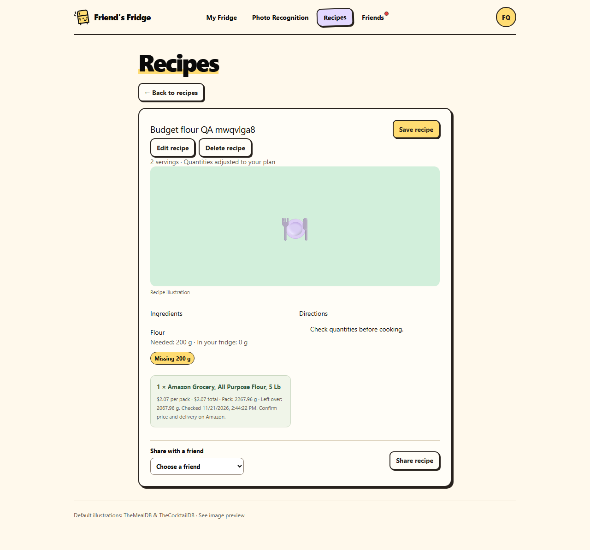
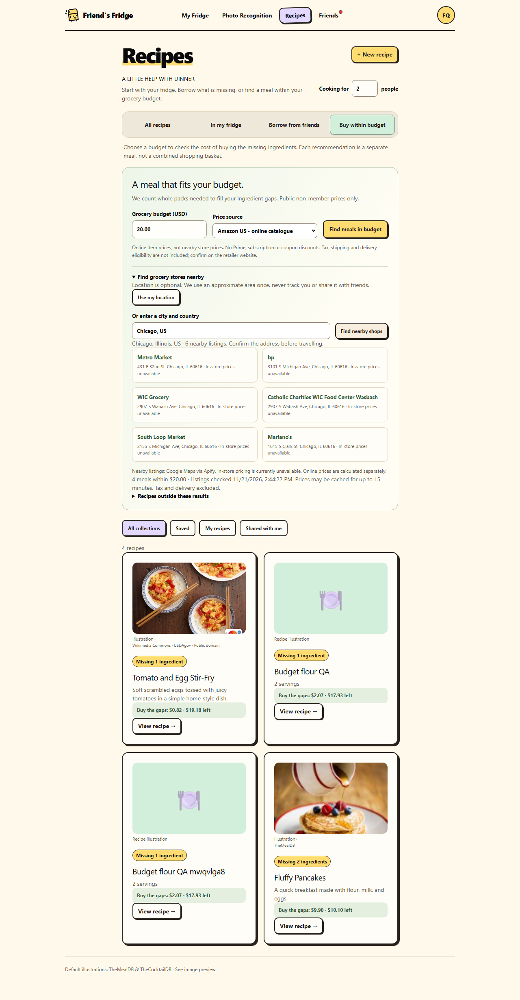
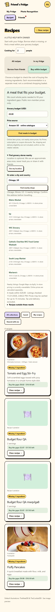

# Friend’s Fridge 优化评估

> 本页的问题表是升级前的基线评估。2026-11-21 后续升级源码已实现全部 P1 项，以及待借数量提示、等价双单位、门便签、附近结果过滤/距离排序/自动折叠、个人导出和旧登录 UI 清理；本地通过，线上自定义房间未更新导致验收未通过，不能标为全部上线。详细状态见 [升级记录](upgrade-acceptance.md)。房间源码增加提交后缓存，写入仍为整体快照；规模化索引、供应商结构化规格和人工无障碍测试仍保留为后续工作。下方旧问题与旧截图用于说明改进动机。

评估日期：2026-11-21。对象为当前 DeepSpace 版本，范围覆盖冰箱交互、菜谱规划、好友借用、报价任务及提交材料。

本报告以代码检查、自动化浏览器验收和已核对的截图为依据。专用人工审查浏览器启动失败，因此不声称完成了人工视觉审查、真实移动设备测试或完整 WCAG 合规审计。可复核的要求映射见 [DeepSpace 实现凭据](deepspace-evidence.md)。

## 结论

当前最值得优化的是报价查询的可靠性与解释能力，不是继续增加新模块。库存、借用和补购已经构成完整的做饭路径；下一步应让用户知道「这次查了哪些菜谱」「为什么某道菜没有报价」「查询失败后如何继续」。

## 优先级与验收标准

| 优先级 | 观察到的问题或限制 | 证据 | 建议与验收标准 |
| --- | --- | --- | --- |
| P1 | 每次点击预算查询都会生成新的请求 ID；轮询遇到网络错误后，用户再点可能启动第二个收费任务。相同 ID 的服务端去重已存在，但客户端重试没有充分利用。 | [客户端 poll](../public/legacy/js/pages/recipes/meal-planner.js)、[服务端 jobCreate](../src/fridge/room.ts) | 保留未完成任务 ID，优先恢复轮询；相同条件的连续重试只创建一个供应商任务。错误时显示“继续查询”，不要重新付费启动。 |
| P1 | 费用上限要求每次只优先查最接近库存的四道菜、最多六种缺少食材。页面尚未充分解释这个范围；未查询、没有匹配规格、缺货目前都可能合并为“价格不完整”。 | [候选选择与报价](../src/fridge/shopping.ts)、[预算界面](../public/legacy/js/pages/recipes/meal-planner.js) | 展示本次查询范围和明确原因；支持用户选择下一组候选。不能让“没有推荐”被理解为“市场上没有预算内食谱”。 |
| P1 | 报价满 15 分钟后的检查发生在重新计算/渲染时；页面一直停留时，没有专用到期提示定时器。 | [quoteFor](../public/legacy/js/pages/recipes/meal-planner.js) | 到期自动标记“报价已过期”，但不自动调用收费接口；用户主动刷新。用可控时钟测试到期与关闭页面后的定时器清理。 |
| P1 | 好友/库存有实时通知，但 Recipes 页没有对应的增量刷新入口。另一个窗口改变库存时，菜谱列表可能仍基于旧数据；后端发起借用和完成交接仍会重新检查权限与库存。 | [refreshLive](../public/legacy/app.js)、[菜谱 load](../public/legacy/js/pages/recipes/recipes.js)、[服务端验证](../src/fridge/domain.ts) | 增加保留筛选和人数条件的菜谱刷新，合并重复通知；库存变化后重新计算缺口，明确标记旧预算方案失效。 |
| P2 | 同一种缺少食材可能有多位好友可提供，每个请求框默认独立填满缺口，用户可能重复请求超过所需数量。库存不会因此立即扣减。 | [借用表单](../public/legacy/js/pages/recipes/meal-planner.js) | 增加“已申请 / 仍需申请”提示或分配草稿；待确认与实际入库继续区分，不能将 pending 请求当库存。 |
| P2 | 规格解析主要依赖商品标题，保守拒绝不明确或双单位商品，降低了错误报价风险，但也降低覆盖率。 | [packageQuantity / normalizeOffer](../src/fridge/shopping-math.ts) | 给供应商增加独立适配层，优先使用已核实的结构化规格；对等价双单位做一致性校验，保留原始规格和转换依据。不可用模型编造重量或价格。 |
| P2 | 首页的冰箱门没有明显的初次使用提示；鼠标光标和键盘语义已有，但手机用户没有悬停反馈。 | [门板语义与结构](../src/fridge/markup.ts)、[点击处理](../public/legacy/js/pages/inventory/inventory.js) | 用门上的便签或已有说明区提示“点击门开关”，保持用户要求的“箱体上不加按钮”。检查 320px/390px 宽度下打开后的实际触控面积。 |
| P2 | 本轮附近商店结果包含 WIC/慈善食品中心和加油站品牌；“grocery store”搜索结果并不保证是人人都能购物的普通超市。 | [本轮线上结果截图](evidence/02-live-nearby-and-budget.png)、[地图结果适配](../src/fridge/shopping.ts) | 按供应商分类、服务类型和可能的资格要求筛选/标注，不仅凭店名判断；有坐标时按距离排序，并标为近似距离。 |
| P2 | 展开六家附近商店后，手机上的实际食谱推荐被推到很下方。 | [390px 线上截图](evidence/03-live-mobile-planner.png) | 定位完成后收起商店列表、仅显示数量摘要，或将商店列表移到食谱结果之后；保留用户主动展开查看的能力。 |
| P2 | 单房间 JSON 快照在每次业务请求中解析，写操作整体序列化；好友库存匹配也有数组扫描，聊天历史会持续增长。 | [state / transactionSync](../src/fridge/room.ts)、[库存与匹配](../src/fridge/domain.ts) | 扩大用户规模前，将库存、好友、消息和请求规范化为有索引的 SQLite 表，并保留交接事务；补充真实规模的延迟测试。当前适合小组演示。 |
| P2 | GitHub 根目录仍是原课程项目的 Node/MongoDB 入口，评审可能运行错目录；保留的旧登录表单与模板页也增加阅读成本。 | [仓库根说明](../../README.md)、[迁移说明](../README.md)、[页面结构](../src/fridge/markup.ts) | 提交完整迁移分支/子目录链接，突出运行目录；清理不再使用的旧登录 UI。不要为了清理代码删除用于数据兼容的 Durable Object 类或旧只读 schema。 |

## 当前已做好的部分

- 默认关门，只点击门或键盘操作才开关；动画防重复触发，关门时内部食材区域为 `inert`，避免隐藏控件被键盘误操作。
- 做饭方式和内容收藏分组，预算条件仅在需要时展开；手机布局改为两列选项、单列输入。
- 借用建议不读取非好友或私密库存；发起请求、交接与配额都由服务器校验。
- 缺失价格不算作零元；整包购买、剩余量、来源链接、检索时间、税费与配送排除项均有说明。
- 地理位置只在点击后请求，提供手动城市替代；附近商店与网上报价明确分开。

## 验收路径与健康状态

1. **注册/登录与进入冰箱：已有自动化覆盖。** 原生登录、资料创建及独立账号身份在回归中验证；真实 Google/GitHub 授权仍需提交者亲自走一次。
2. **手动开关门：已有自动化覆盖。** 默认关闭、点击箱体不触发、点击门打开和关闭，以及减少动画设置均已检查；真实手机触控/屏幕阅读器待人工验证。
3. **选择借用菜谱并请求食材：本地与最终线上回归通过。** 测试显式构造缺口、共享可见性并恢复库存，避免把“已经有食材”误判为推荐失败。
4. **按预算查询商品与查看整包金额：本地及线上真实接口验收通过。** 线上记录还覆盖了任务归属和相同任务 ID 的重放；详细结果见凭据文档，不代表价格或供应商永远可用。
5. **查找附近商店：已验证真实城市查询。** 浏览器定位使用测试坐标验证授权后的流程；真实 GPS 精度、商店地址正确性和实际到店价格不在自动化证明范围内。

## 建议执行顺序

先做 P1 的任务恢复、查询范围说明、报价到期和库存刷新；再完善多好友借用分配与商品规格覆盖。最后根据真实使用规模决定是否拆分快照存储。这样比新增购物车、自动下单或更多外部集成更能提升这份提交的完成度。

## 本轮自动化截图证据

这些是已经核对的线上验收截图，不是通过专用审查浏览器完成的人工视觉审计。图中的 QA 菜谱用于验证数量与报价逻辑。

1. **采购详情：功能通过。** 可看到整包价格、所需数量、剩余量、商品来源与时间；仍需真实用户验证信息是否足够易读。

   

2. **附近商店与预算：基本可用。** 公开网上价与本地门店价已有区分；列表分类和推荐区域的位置值得优化。

   

3. **手机：布局通过自动化横向溢出检查，纵向动线待改进。** 真机触控、缩放与屏幕阅读器仍需人工测试。

   
